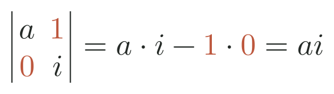

# det AI lab — brand assets

Logo and wordmark for **det AI lab**, designed October 2026.

<picture>
  <source media="(prefers-color-scheme: dark)" srcset="assets/det-ai_formula_dark_transparent.svg">
  
</picture>

| File | Use |
|---|---|
| `assets/det-ai_paper_regular*` | Primary mark (large sizes) |
| `assets/det-ai_paper_bold*`, `det-ai_paper_avatar*` | Small sizes, avatars, favicons |
| `assets/det-ai_lockup_detailab*` | Horizontal lockup: mark + "det AI lab" |
| `assets/det-ai_lockup_lab*` | Horizontal lockup: mark + "lab" |
| `assets/det-ai_formula*` | The determinant behind the mark |

Colors: sage `#BECBB3` · rust `#BD573D` · ink `#252A27`
Typeface: Latin Modern (GUST Font License), outlined to paths.

© 2026 det AI lab. All rights reserved. The logo and wordmark may not be used without permission.
